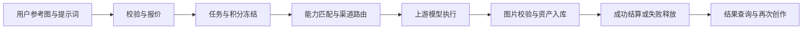
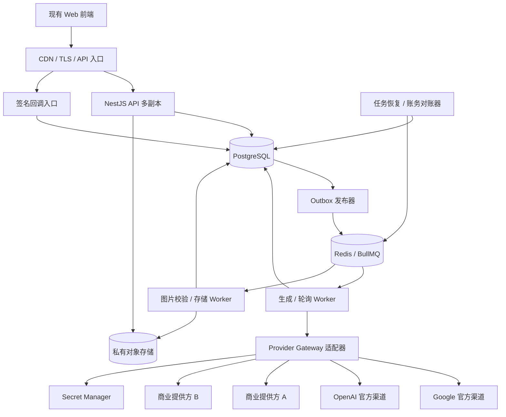
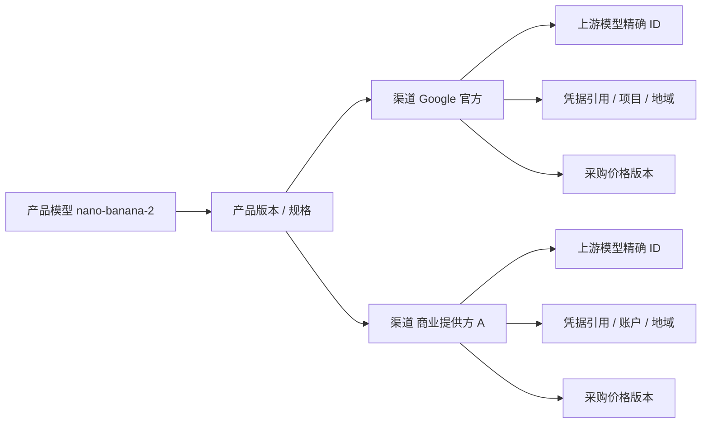

# VIVIAI 后端架构设计

日期：2026-09-06。技术基线：TypeScript + NestJS。范围：承接已完成的前端 Mock，支持多 API 提供方的生产后端设计。

## 1. 从产品目标推导架构

用户购买的是“给定参考图和要求，得到可用的新图片”。后端必须保证四件事：输入不丢失、任务有确定归宿、计费能解释、提供方变化不破坏用户已选择的效果规格。

因此，核心不是做一个转发 API Key 的代理，而是管理一个有成本、有状态、可追溯的生产过程：

必须区分三个计量单位：

| 单位 | 举例 | 用途 |
|---|---|---|
| 用户任务 Job | 一次点击生成 4 张 | 表单、报价、进度与用户记录 |
| 出图项 Item | 第 1 张、第 2 张 | 并发、部分成功、交付和结算 |
| 上游尝试 Attempt | 第 2 张先走 A，再安全切到 B | 请求追踪、真实采购成本、重试与对账 |

禁止把这三者合成一张任务表后，用一个 `retry_count` 和一个 `cost` 掩盖多个实际调用。

## 2. 方案选型

| 方案 | 优点 | 主要代价 | 决策 |
|---|---|---|---|
| 模块化单体 + 独立 Worker | 本地事务明确、部署少、可单独扩容耗时任务 | 需要维护模块边界 | 首发采用 |
| 多微服务 + 消息总线 | 组织与容量可以独立扩展 | 分布式事务、运维和排障成本高 | 规模/团队边界形成后再拆 |
| 边缘函数直接转发生图 | 简单请求上线快 | 长任务、未知结果恢复、资金事务和二进制处理较难 | 边缘层只负责静态站与入口 |

### 2.1 技术组件

| 组件 | 选择 | 责任 |
|---|---|---|
| API | NestJS，TypeScript，Node.js LTS | 认证、业务命令、查询、回调入口 |
| 数据访问 | Prisma 管理常规模型/迁移，事务内可用参数化 SQL | 钱包/任务锁、约束、Outbox |
| 主库 | PostgreSQL，托管主备优先 | 任务、积分、订单、资产元数据、渠道配置 |
| 队列/缓存 | Redis + BullMQ | 调度、延迟轮询、短期缓存、速率令牌 |
| 图片存储 | 私有 S3 兼容对象存储 | 用户原图、生成图、缩略图与短期中间结果 |
| 文件处理 | 独立受限 Worker，Sharp 等成熟图像库 | 解码、真实尺寸、缩略图和元数据清理 |
| 合约 | OpenAPI 文档 + 自动生成前端 DTO | 接口字段与错误码一致 |
| 可观测性 | OpenTelemetry + 指标/结构化日志 | trace、延迟、失败、资金异常、供应商健康 |
| 密钥 | 云 Secret Manager/KMS，工作负载身份 | API 密钥、支付证书、轮换与审计 |

框架和 SDK 使用实施时受支持的稳定版本并锁定 lockfile；模型版本独立于依赖版本发布。NestJS 提供 BullMQ 集成，但队列重试不承担业务计费幂等职责。[NestJS 队列文档](https://docs.nestjs.com/techniques/queues)

### 2.2 单库模块边界

| 模块 | 拥有的数据/职责 | 禁止越界 |
|---|---|---|
| Identity | 用户、会话、邮箱验证、角色 | 不改积分余额 |
| Catalog | 产品模型、规格、套餐、工具/示例版本 | 不直接调用上游 |
| Asset | 上传、私有访问、生成图片接收、保留策略 | 不根据任意外链抓图 |
| Generation | Job、Item、输入快照、任务状态 | 不掌握提供方字段细节 |
| Provider Gateway | 渠道、能力、适配器、Attempt、用量 | 不自行扣用户积分 |
| Wallet | 积分批次、冻结分配、不可变流水 | 不发起模型请求 |
| Billing | 订单、支付、权益周期、对账 | 不信任客户端支付完成声明 |
| Workflow | 定义版本、运行批次、单元格执行 | 不复用上一批结果推导当前批状态 |
| Community | 灵感、点赞、收藏、可选示例库 | 不泄露私有资产 |
| Operations | 配置发布、停用渠道、补偿、审计 | 不允许直接 SQL 改余额 |

API 和 Worker 可以共用这些模块及数据库事务；逻辑上由各模块拥有写入规则。未来拆分的优先顺序是图片处理、Provider Gateway、社区查询，最后才考虑拆账务。

## 3. 总体部署图

其中 Gateway 是共享代码模块，不要求首发新增一个独立网络服务。任务消息只携带内部 ID 和事件版本，不携带原图、完整提示词、密钥或大段上游响应。

### 3.1 运行进程

- `api`：短请求、鉴权、报价、冻结入单、查询与回调入箱。
- `generation-worker`：预提交、上游请求、提交结果持久化；同步协议可在 Worker 持有长连接，不占用用户请求。
- `maintenance-worker`：Outbox 发布、到期轮询、失联任务恢复、积分到期和支付/用量对账。
- `image-worker`：大图片下载、解码、缩略图、存储与内容检查。首发可同镜像分队列运行，但进程限制 CPU 和内存。

本地用容器编排启动；生产优先托管数据库、Redis 和对象存储，加少量容器实例。没有流量证据时不强制 Kubernetes。

## 4. 多提供方的五层关系

“模型名称相似”和“接口兼容 OpenAI”都不代表输出能力一致。一个产品规格只有在渠道验收通过后才建立映射。

自动路由按以下顺序：可用地域与数据处理政策 → 真实模型身份与任务能力 → 输出尺寸/参考图要求 → 配额及健康 → 成本预算 → 排队与延迟。排序靠后的因素不能覆盖前面的硬条件。

对用户固定承诺 `productModelVersion + outputSpec + maxCredits`。上游切换可以变化供应商，但不能暗中把 Pro 换 Lite、把 4K 改 1K，或丢掉用户上传的第二张图。跨模型兜底属于新的用户可见选择，需要重新报价。

首发只启用少量验证过的渠道：一个目标图片模型的主渠道与一个等价备用渠道。OpenAI 等不同模型家族作为独立产品模型，而非 Nano Banana 的隐形替代。

## 5. 两条核心业务链路

### 5.1 用户参考图复刻

1. 用户上传爆款参考图；服务端识别 MIME/尺寸并存入私有对象存储，返回持久化 `assetId`。
2. 可选添加主体素材，输入保留/修改要求。服务端明确标记 `reference`、`subject` 角色。
3. 报价服务根据有效产品规格、输入上限、计费模式与渠道成本生成有版本的报价。
4. 提交事务同时创建 Job/Item、冻结积分和写入 Outbox，返回任务 ID。
5. Worker 按 Item 匹配渠道，写入 Attempt 之后调用上游。同步、异步均归入相同业务状态机。
6. 返回图片先落隔离存储，校验、审核并完成资产元数据写入，随后结算该 Item。
7. 部分成功只结算已交付项；其余冻结释放。用户在同一页面查看结果并继续修改。

是否做独立视觉分析是业务策略。首发直接将真实参考图片与提示词传给支持编辑的模型，避免额外一次分析增加延迟和成本；后续可加入版本化、可审计的分析步骤，不使用固定文案冒充分析。

### 5.2 工作流批量生产

一个 Workflow 定义可生成多个不可变 Run。一个 Run 包含多个单元格 Job，每个 Job 可有多个出图 Item。依赖引用固定到该 Run 内的上游资产；重跑生成新的 Run，不覆盖旧批次。

工作流“批量”指产品里的多任务编排，不代表自动使用提供方离线 Batch。后者作为独立 `executionMode=deferred`，只有用户选择较长交付时限且目标渠道实际支持时才使用。[Gemini Batch API](https://ai.google.dev/gemini-api/docs/batch-api)

## 6. 一致性与失败原则

### 6.1 系统保证什么

- 同一用户、同一幂等键和相同业务输入，只创建一个 Job。
- 同一 Item 至多交付一个胜出结果，冻结积分只结算或释放一次。
- 重复、乱序回调不会重复入库、重复扣分。
- 已提交到上游的请求不因 Worker 崩溃而盲目再次提交。
- 成功对用户可见时，对应资产已经能由受控下载接口读取。

这不等于跨互联网“恰好调用一次”。提供方不支持幂等或结果查询时，请求发出后连接中断无法证明是否执行。系统将其标记为 `submission_unknown`，限制后续调用并按期限与成本预算收敛。

### 6.2 不能混淆的失败

| 情况 | 正确行为 |
|---|---|
| 明确未被接收，如验参失败 | 修正输入或停止；不算成功出图 |
| 明确限流且未执行 | 按 Retry-After 延后，或安全换等价渠道 |
| 已拿到 providerTaskId | 查询该请求，不能新建同一出图请求 |
| 发送后网络超时/连接重置 | 进入未知态，先查原请求和账单 |
| 模型成功但下载失败 | 重试下载/持久化，不重新付费生图 |
| 图片落存储但数据库失败 | 用确定对象键重放入库；孤儿对象后台回收 |
| 用户已退款后收到迟到结果 | 记录上游成本并隔离结果，不悄悄重新扣分 |

Redis 锁只辅助运行，资金与任务条件更新以 PostgreSQL 行锁和唯一约束为准。[PostgreSQL 显式锁](https://www.postgresql.org/docs/current/explicit-locking.html)

## 7. 经营成本与定价架构

用户销售账与上游采购账分开维护：

- 销售：积分批次的取得成本、消耗、到期、现金订单、退款与活动补贴。
- 采购：每次 Attempt 的实际/估算用量、原币金额、汇率版本、失败费用、重复请求费用、存储与下载费用。

报价锁定用户最多支付的积分。渠道涨价或切换带来的差额由平台预算决定承担或停止服务，不能完成后追扣用户未确认的积分。

用户买到的积分单价因套餐不同而变化；赠送积分不是收入。毛利决策按实际消耗积分批次的收入归因和采购成本衡量，不能固定假设“1 积分永远等于某个人民币金额”。

生产上架必须有可解释的价格数据来源。原有 Mock 价格只服务演示，不能直接拿来覆盖官方输入图片、文本、输出图、失败尝试和第三方加价。

## 8. 数据与安全边界

- 浏览器不获得提供方密钥；不直接调用模型 API。提供方调用限于允许的数据处理区域及经审核的渠道域名。
- 用户上传、提示词、图像输出和对话历史均带租户/用户归属。所有资源访问必须验证归属或公开授权。
- 预签名地址是短时访问凭证，不是永久公开链接；初始 TTL 5 分钟。上游队列需要延后读取图片时，TTL 须匹配该渠道的排队上限，或用私有文件上传协议替代。[S3 预签名 URL](https://docs.aws.amazon.com/AmazonS3/latest/userguide/using-presigned-url.html)
- 模型返回 URL、回调字段和文件均为不可信输入，下载只允许登记的域名和公网目标，逐次校验重定向。
- 上游错误原文、签名 URL、图片 Base64、API Key 和支付原文不进入普通日志。
- 生产部署完全关闭 `/api/mock/*`，不能通过浏览器“支付成功”按钮发积分。
- 本设计采用正式 API 凭据与商业接口；账号订阅网页不作为提供方协议。

区域在架构上配置为 `processingRegion`、`allowedRegions`、`dataPolicy`，具体云厂商与可用账号由部署时选定；网络可达不等于业务可用或合同允许。

## 9. 初始容量与服务目标

以下是假设目标，不是已测性能：首发约 1,000 日活、10,000 张/日、短时 10 张/秒提交。API 目标 P95 小于 500ms（不含文件流和模型执行），创建成功后 P95 2 秒内可被调度器发现。

平均吞吐约 `10,000 / 86,400 ≈ 0.116 张/秒`。若模型平均耗时 45 秒，则平均在途约 5.2；持续 10 张/秒会要求约 450 个上游在途槽位。无法靠增加 API 副本消除上游配额瓶颈，因此必须有排队上限、预估等待与背压。

若每张保留原图与缩略图共约 3.3MB，10,000 张/日约 33GB/日，90 日约 3TB，另计用户上传、版本、备份和下载流量。文件保留策略作为套餐权益配置，首发可按 90 日默认，并在到期前通知用户。

首发生产建议：API 至少两副本；Worker 按队列等待与上游配额扩缩容；主库自动备份与时间点恢复；Redis 开持久化但保留数据库重建队列能力。容灾设计目标 RPO ≤5 分钟、RTO ≤60 分钟，需通过恢复演练验证。

监控包含：受理率、排队 P95、上游成功率、未知提交量、下载失败率、每张实际成本、未对账支出、冻结超时、重复回调、钱包不平衡、渠道预算消耗与过期队列。

## 10. 设计默认值

| 项目 | 首发默认 | 变更方式 |
|---|---|---|
| 单次生成张数 | 1–4，内部每 Item 1 张 | 产品规格发布 |
| 复刻参考图片 | 必填 1 张 reference，可选 1 张 subject | 产品版本发布 |
| 图片输入 | JPG/PNG/WebP，每张 ≤5MB，解码后 ≤40MP | 产品与安全配置 |
| 单用户执行并发 | 套餐 2/5/10 个出图 Item；排队不占执行槽 | 套餐权益 |
| 用户活动受理单元上限 | 独立 Job + Run 合计 20；Run 内子 Job 不重复计数；用户排队最多 200 Item | 防刷与容量配置 |
| 工作流单 Run | 最多 200 Item；默认最长 2 小时，报价显示截止时间 | 工作流策略与容量准入 |
| 报价有效期 | 5 分钟，过期重新确认 | 价格服务 |
| 普通任务排队截止 | 5 分钟 | 执行策略 |
| 普通任务交付截止 | 自创建 15 分钟 | 执行策略与渠道能力 |
| 普通任务安全重提交 | 每 Item 最多 2 次总上游尝试 | 路由预算版本 |
| 提供方状态轮询 | 2、4、8、15 秒，带随机抖动 | 渠道配置 |
| Outbox 扫描 / 恢复扫描 | 1 秒 / 30 秒 | 运维配置 |

这里的并发按出图项执行计数，和旧 Mock 的“排队中 + 生成中任务数”不同。前端需同步修改文案；批量用户可以排队，不能把 200 项工作流一次性打到提供方。

## 11. 研发分期与交付边界

| 阶段 | 可交付闭环 | 验收门槛 |
|---|---|---|
| A 基础链路 | 真实账号、持久化上传、目录/报价、任务/钱包/Outbox，受控模拟提供方 | 重复提交、崩溃恢复、部分成功账务通过 |
| B 首个真实渠道 | 参考图复刻 → 正式 API → 图片私有存储 → 结算 | 输入角色、输出尺寸、失败与用量账通过实测 |
| C 多渠道 | 第二个等价渠道、路由、熔断、未知提交与对账 | 不重复扣分、不盲目重试、不静默降级 |
| D 商业闭环 | 支付、权益周期、退款、套餐价格、运营审计 | 支付重放与月度权益幂等通过 |
| E 批量与优化 | Workflow Run、批量报价、可选离线模式、成本报表 | 新旧批次隔离、依赖、排队公平性通过 |

设计覆盖全部阶段，实施应逐阶段验收。详细接口、事务边界与故障测试见[详细设计](./02-后端详细设计.md)，提供方接入见[接入规范](./03-多API提供方接入规范.md)。
