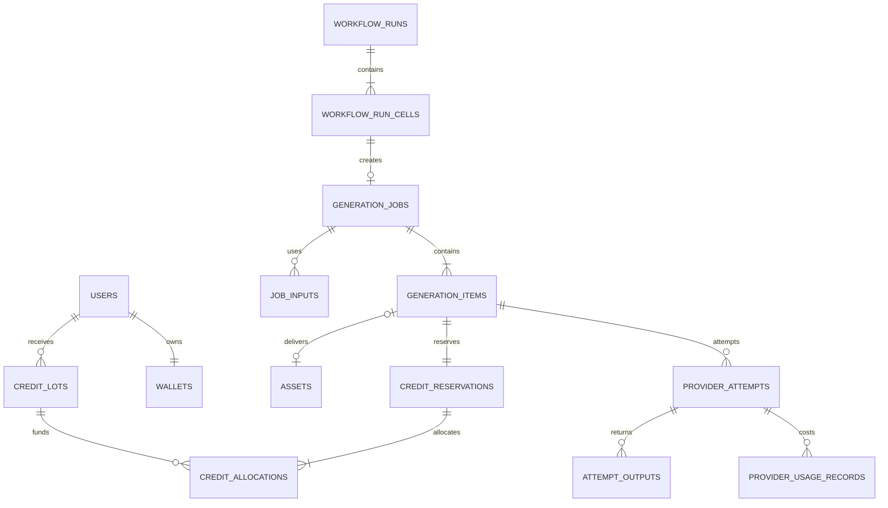
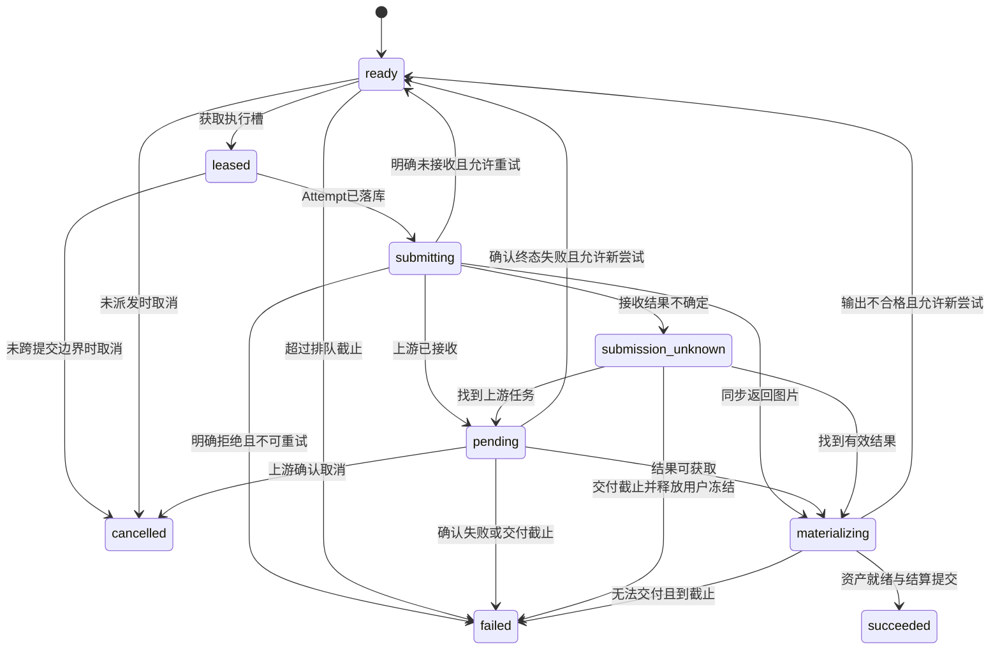

# VIVIAI 后端详细设计

日期：2026-09-06。适用范围与默认值以[架构设计](./01-后端架构设计.md)为准；上游字段转换见[提供方接入规范](./03-多API提供方接入规范.md)。本文定义业务规则、表结构逻辑、接口和事务，不是已执行的数据库迁移。

## 1. 工程与模块结构

建议新增独立目录 `viviai-server/`，当前前端继续保留在 `viviai-web/`。不将 NestJS 生命周期嵌入前端 Vinext 服务。

```text
viviai-server/
  apps/
    api/src/main.ts                 HTTP、鉴权、原始回调请求体
    worker/src/main.ts              生图、轮询、落图队列消费者
    maintenance/src/main.ts         Outbox、超时、过期、对账调度
  src/modules/
    identity/                      用户、会话、验证码、权限
    catalog/                       产品模型、输出规格、报价、工具配置
    assets/                        上传、校验、私有访问、删除恢复
    generation/                    Job/Item、状态、提交、取消、结算协调
    providers/                     渠道配置、路由、适配器、Attempt、成本
    wallet/                        积分批次、冻结分配、积分流水
    billing/                       订单、支付回调、权益周期、退款
    workflows/                     定义版本、Run、依赖图、单元格结果
    community/                     灵感、点赞、收藏、可选示例
    notifications/                 站内通知、未读标记
    operations/                    管理接口、审计、补偿与对账
  src/shared/
    database/                      事务客户端、Outbox、Inbox
    queue/                         队列名、消息版本、发布器
    observability/                 trace、指标、日志脱敏
    contracts/                     公共 DTO、错误码、OpenAPI
  prisma/                          数据模型和逐步迁移
  test/
    contract/                      前后端及提供方协议测试
    integration/                   PostgreSQL/Redis/存储集成测试
    fault/                         崩溃、超时、重放、乱序注入
    e2e/                           上传到交付、支付到权益
```

Controller 只做鉴权/解析/响应，Application Service 管理事务和用例，领域规则无 HTTP/SDK 依赖。任务调度器调用统一提供方接口，禁止在 Controller 中直接调用模型 SDK。

## 2. 数据类型、归属与版本规范

- 主键采用服务端生成 UUID，HTTP 中为字符串；可由用户直接查询的私有业务表有 `user_id`，内部子表通过强制外键继承归属，查询必须连接归属条件。未来团队可再增加 workspace 层，首发不引入未使用的复杂租户体系。
- 积分以整数最小单位保存，`bigint`，首发 1 单位=1 积分。API 中将用户余额限制在 JavaScript 安全整数范围内；管理导出中的大数以字符串表示。
- 现金订单用整数分 `amount_fen`；上游成本用 `numeric(20,8)` + ISO 币种；汇率用 `numeric(20,10)`。禁止浮点累计账务。
- 时间统一 `timestamptz` UTC；前端按用户时区展示。索引与游标使用 `(created_at, id)`。
- 引用私有资源时，资源 `user_id` 必须等于调用主体。数据库能表达的同归属引用采用组合外键 `(user_id,id)`；其余由授权服务在同一事务内校验。
- 模型、套餐、路由、价格、工具提示模板和 Workflow 发布后生成不可变版本；历史 Job 保存当时版本及必要快照，不能回查当前价格替代历史价格。
- 对外响应有 `requestId`；内部串联 `traceId/jobId/itemId/attemptId/providerRequestId`。不把 providerRequestId 当用户权限凭证。

## 3. 逻辑数据模型

### 3.1 账户与权益

| 表 | 核心字段 | 约束 / 索引 |
|---|---|---|
| `users` | id、email_normalized、username、password_hash、status、avatar_asset_id、invite_code | email、invite_code 唯一 |
| `sessions` | id、user_id、token_hash、expires_at、revoked_at、last_seen_at | token_hash 唯一；user_id/expires_at |
| `email_challenges` | id、purpose、email_hash、code_hash、expires_at、attempts、consumed_at | email_hash/purpose；验证码只存摘要 |
| `anonymous_sessions` | id、cookie_hash、expires_at、claimed_user_id | cookie_hash 唯一 |
| `plan_versions` | id、plan_code、version、price_fen、currency、cycle、credits_per_period、concurrency、entitlements | plan_code/version 唯一 |
| `subscriptions` | id、user_id、plan_version_id、starts_at、ends_at、status、renewal_policy | user_id/status；唯一订单来源 |
| `subscription_periods` | id、subscription_id、period_start、period_end、credit_lot_id、grant_status | subscription_id/period_start 唯一 |

真实密码用 Argon2id 等成熟密码哈希库保存，不能照搬 Mock 的纯内存摘要。会话 Cookie 使用 HttpOnly、Secure、SameSite，写请求校验 CSRF/Origin。登录后轮换会话标识，验证码 10 分钟失效、最多尝试 5 次、重发冷却 60 秒；这些是应用初始策略，另加 IP/账号速率限制。

### 3.2 模型、渠道、报价

| 表 | 核心字段 | 约束 / 索引 |
|---|---|---|
| `product_models` | id、public_code、display_name、status、active_version_id | public_code 唯一；兼容 nano-banana-2 等前端标识 |
| `product_model_versions` | id、product_model_id、version、model_identity、capabilities_json | product_model_id/version 唯一 |
| `output_specs` | id、model_version_id、resolution_label、ratio、quality、width、height、format、size_policy | 版本内规格 key 唯一；禁止仅用 4K 标签推断尺寸 |
| `providers` | id、code、name、protocol、enabled、contract_ref、allowed_regions | code 唯一 |
| `provider_credentials` | id、provider_id、secret_ref、secret_version、account_ref、quota_scope_id、enabled | 不保存明文 Key；quota_scope_id 聚合同项目配额 |
| `provider_channels` | id、provider_id、credential_id、base_url、region、upstream_model_id、upstream_model_version、equivalence_group、enabled | 明确到账户/地域/模型，不只是提供方名称 |
| `channel_capability_versions` | id、channel_id、version、spec_mapping_json、input_modes、limits_json、verification_run_id | channel_id/version 唯一；与接入报告关联 |
| `product_channel_bindings` | id、product_model_version_id、channel_capability_version_id、enabled | 两版本关联唯一 |
| `supplier_price_versions` | id、channel_id、currency、billing_dimensions_json、effective_at、source_ref、verified_at | 不同生效区间不重叠 |
| `retail_price_versions` | id、model_version_id、output_spec_id、execution_mode、unit_credits、input_allowance_json、effective_at | 版本发布后不修改 |
| `route_policy_versions` | id、name、version、hard_filters_json、weights_json、limits_json | name/version 唯一 |
| `quotes` | id、principal_type、principal_id、input_digest、model_version_id、retail_price_version_id、route_policy_version_id、item_quotes_json、total_credits、cost_ceiling、expires_at、consumed_job_id、consumed_run_id | 两个 consumed 字段最多一个非空，各自外键且部分唯一；工作流按 item_quotes 保存不同模型/价格 |

报价里的候选渠道快照是“当时允许的集合”。真正派发时重新检查停用、凭据、地域、能力和成本，不能因为报价仍有效而绕过紧急停用。

单任务报价绑定 Job，工作流报价绑定 Run；工作流子 Job 引用父 Run 的报价分项，不能再次消费该报价。匿名报价只供价格预览，登录并认领图片后须重新获取本人报价，不能仅修改 principal_id 继续使用。创建任务和 Run 均要求登录。

### 3.3 任务与执行

| 表 | 核心字段 | 约束 / 索引 |
|---|---|---|
| `generation_jobs` | id、user_id、source、operation、idempotency_key、workflow_run_id、quote_item_keys、input_snapshot、model_version_id、output_spec_id、quote_id、status、cancel_requested_at、requested_count、success_count、charged_credits、deadline_at、version、retry_of_job_id | `(user_id,operation,idempotency_key)` 部分唯一；user_id/created_at/id；工作流子 Job 由 cell 唯一绑定 |
| `generation_items` | id、user_id、job_id、ordinal、state、stage、fence_token、lease_owner、lease_expires_at、current_attempt_id、winner_attempt_id、next_action_at、deadline_at、result_asset_id | job_id/ordinal 唯一；state/next_action_at；result_asset_id 唯一 |
| `job_inputs` | id、user_id、job_id、asset_id、role、ordinal、sha256、source_version | job_id/role/ordinal 唯一；role=reference/subject/context |
| `provider_attempts` | id、item_id、attempt_no、channel_id、credential_version_ref、capability_version_id、supplier_price_version_id、state、request_digest、provider_request_id、submitted_at、accepted_at、finished_at、next_action_at、cost_reservation_group_id、error_code、acceptance、billing_certainty | item_id/attempt_no 唯一；账号配额域/上游请求ID部分唯一；state/next_action_at |
| `attempt_outputs` | id、attempt_id、output_index、staging_object_key、sha256、mime、width、height、validation_state | attempt_id/output_index 唯一 |
| `provider_usage_records` | id、attempt_id、event_key、usage_version、source、dimensions_json、currency、amount、fx_version、amount_cny、certainty、invoice_ref、supersedes_id | event_key 唯一；attempt_id/usage_version 唯一 |
| `channel_budgets` | id、scope_id、period_start、period_end、currency、ceiling、reserved、booked | scope_id/period_start 唯一 |
| `cost_reservations` | id、attempt_id、group_id、budget_id、reserved_upper_bound、status、resolved_amount | attempt_id/budget_id 唯一；status/created_at |
| `execution_leases` | id、item_id、attempt_id、quota_scope_id、user_id、state、user_slot_released_at、provider_slot_released_at、lease_expires_at、upstream_deadline_at | item_id 活跃调度租约唯一；attempt_id 唯一；quota_scope_id/state |

`upstream_model_version` 不明确时标为 `unverified`，不能加入严格等价故障转移组。用量来源区分 `response`、`invoice`、`estimate`、`allocated`；最后一种用于明确标注的账单分摊，未知不能写成零。上游请求关联使用提供方实际 ID 命名空间（账号/项目及必要的端点），不把两个渠道配置中的同一远端请求记成两次执行。

### 3.4 积分与订单

| 表 | 核心字段 | 约束 / 索引 |
|---|---|---|
| `wallets` | user_id、available、held、consumed、expired、revoked、version | user_id 主键；所有余额非负 |
| `credit_lots` | id、user_id、source_type、source_id、issued、available、held、consumed、expired、revoked、expires_at、net_revenue_fen、subsidy_budget_id | source_type/source_id 唯一；user_id/expires_at |
| `credit_reservations` | id、user_id、job_id、item_id、amount、status、settled_at | item_id 唯一；状态 held/consumed/released |
| `credit_allocations` | id、reservation_id、lot_id、amount | reservation_id/lot_id 唯一 |
| `credit_events` | id、user_id、lot_id、reservation_id、business_key、type、issued_delta、available_delta、held_delta、consumed_delta、expired_delta、revoked_delta、created_at | business_key 唯一；不可变追加；user_id/created_at/id |
| `orders` | id、user_id、plan_version_id、amount_fen、currency、payment_channel、status、expires_at、provider_trade_no、paid_at、fulfillment_status | 支付渠道/交易号唯一；创建幂等键唯一 |
| `payment_events` | id、channel、event_id、order_id、payload_digest、verified_at、processed_at | channel/event_id 唯一 |
| `refund_orders` | id、order_id、user_id、amount_fen、reason、status、provider_refund_no、credit_reversal_ref | 退款操作幂等键唯一 |

钱包为批次的汇总读模型，同步在数据库事务中更新。每个批次满足：

```text
issued = available + held + consumed + expired + revoked
wallet.available = Σ lot.available
wallet.held = Σ lot.held
reservation.amount = Σ allocation.amount
```

每条事件满足 `issued_delta = available_delta + held_delta + consumed_delta + expired_delta + revoked_delta`。冻结/消费/释放不增加 issued；现金购买、注册赠送的 grant 事件增加 issued；撤销未消费积分通过 available→revoked，不抹掉历史发行量。

跨多个批次分配时，每个 lot 追加一条事件；幂等 business_key 使用 `reservationId:动作:lotId`，grant 使用 `来源类型:来源ID:lotId`。不能用只有 reservationId 的唯一键阻断同一次结算的第二个批次。

### 3.5 文件、工作流及基础设施

| 表 | 核心字段 | 约束 / 索引 |
|---|---|---|
| `assets` | id、user_id、anonymous_session_id、object_key、object_version、sha256、mime、bytes、width、height、source、status、visibility、created_at、deleted_at、retention_until | object_key/version 唯一；正常私有资产只能有一个归属主体 |
| `upload_sessions` | id、user_or_anon_id、object_key、expected_bytes、mime_hint、expires_at、status | object_key 唯一；过期索引 |
| `asset_pins` | asset_id、owner_type、owner_id、created_at、released_at | asset/owner 唯一；活动 pin 部分索引；owner 为 Job/Run |
| `workflows` | id、user_id、name、current_version、updated_at | user_id/updated_at |
| `workflow_versions` | id、workflow_id、version、definition_json、created_at | workflow_id/version 唯一 |
| `workflow_runs` | id、user_id、workflow_version_id、quote_id、operation、idempotency_key、deadline_at、status、total_items、completed、failed、cancel_requested_at | 创建幂等键唯一；quote_id 唯一；user_id/created_at |
| `workflow_run_cells` | id、run_id、row_id、column_id、job_id、state、result_asset_ids、output_binding | run_id/row_id/column_id 唯一 |
| `workflow_dependencies` | run_id、from_cell_id、to_cell_id、input_role、output_index | 依赖边唯一；建图时保证无环 |
| `outbox_events` | id、aggregate_type、aggregate_id、event_type、event_version、payload、available_at、lease_until、published_at | 聚合/事件版本唯一；未发布部分索引 |
| `inbox_events` | id、provider_id、credential_id、dedupe_key、provider_request_id、payload_digest、raw_object_key、status、received_at | provider_id/credential_id/dedupe_key 唯一 |
| `idempotency_records` | user_id、operation、key、request_hash、response_status、response_body_ref、resource_id | user_id/operation/key 唯一 |
| `audit_logs` | id、actor_id、action、resource_id、before_hash、after_hash、reason、request_id | 时间分区；只追加 |

辅助表：`inspirations`、`inspiration_likes`、`asset_favorites`、`viral_template_versions`、`tool_template_versions`、`notifications`、`invite_relations`、`redeem_codes`。点赞/收藏用 `(user_id,target_id)` 唯一约束；邀请奖励按被邀请用户唯一发放；卡密按兑换用户和可使用次数事务核减，不能靠前端去重。

阶段 E 如启用提供方离线 Batch，增加 `provider_batches(id,channel_id,credential_version_ref,provider_batch_id,input_object_key,state,deadline_at,next_action_at)` 与 `provider_batch_items(batch_id,line_key,item_id,attempt_id,state)`。渠道账号/远端批次 ID 唯一，批次/line_key 唯一，attempt_id 唯一；提交批次前为全部可能收费行原子预占预算，未知提交遵循普通 Attempt 的保守恢复原则。

### 3.6 核心关联



## 4. REST 契约与现有前端兼容

### 4.1 公共规则

沿用 `/api` 前缀、camelCase 字段和 `{data,message,requestId}` 响应。新增顶层 `meta` 承载分页；现有列表的 `data` 仍然是数组。身份来自服务端会话，不接受 body 中的 userId 覆盖。

写入接口对创建类操作要求 `Idempotency-Key`，最长 128 字符。固定同一用户/操作/键的 request_hash；相同输入重放原资源和响应，不同输入返回 `409 IDEMPOTENCY_CONFLICT`。已成功创建的任务即使报价已过期，重放也应先返回原任务。业务对象长期保留操作键摘要，不能仅靠 24 小时 Redis 过期键防重复。

资源不存在与无权限均返回不泄露存在性的 404。列表必须服务端过滤 user_id。分页默认 30、最大 100，使用 opaque cursor；对外时间为 ISO 8601。

### 4.2 首发接口表

| 接口 | 关键请求 / 返回 | 行为 |
|---|---|---|
| POST `/auth/register` | username/email/password/code → User | 校验验证码、建真实账号、唯一注册积分发放 |
| POST `/auth/login`、`/auth/logout` | 账号口令 / 无 → User/null | 登录设置 Cookie；登出撤销会话 |
| POST `/auth/send-code`、`/auth/reset-password` | email/purpose；email/code/password | 限流、摘要、一次消费；重置后撤销其他会话 |
| GET `/me` | User/null | 包含真实可用/冻结积分、当前权益 |
| GET `/models` | ModelConfig[] + capabilities/priceVersion | 仅返回可售能力；区分产品 ID 和上游 ID |
| POST `/generation-quotes` | 输入、规格、executionMode → Quote | 校验资产/规格；报价不冻结积分 |
| POST `/workflow-quotes` | workflowId/version/rowIds → Quote | 展开该版本的全部出图项、依赖和规格，返回逐项积分与 Run 截止时间 |
| POST `/generation-tasks` | quoteId + GenerationInput → GenerationTask | 原子受理，202 |
| POST `/remix-tasks` | quoteId/referenceAssetId/subjectAssetId?/adaptation/strength/参数 | 必须存在有效主参考图；不要求 templateId |
| GET `/generation-tasks`、`/:id` | cursor/filter → Task[] / Task | 任务归属校验；可包含 items 摘要 |
| POST `/generation-tasks/:id/cancel` | 无 → Task | 请求取消；按阶段返回结果，不承诺执行后免费停止 |
| POST `/generation-tasks/:id/retry` | itemIds + quoteId → 新 Task | 仅重试选中的失败项；新报价、新冻结，保留 retryOfJobId |
| GET `/generation-tasks/:id/events` | Last-Event-ID → SSE | 后续可选；首发保留轮询 |
| POST `/remix-references` | multipart file → UploadedReference | 兼容现有上传方法；持久化真实资产 |
| POST `/upload-sessions`、`/:id/complete` | 元数据 → 预签名地址；完成通知 → Asset | 大规模时改浏览器直传，完成须服务端校验 |
| GET `/assets`、`/assets/:id` | 筛选/游标 → Asset[] / Asset | 签名预览地址短时生成 |
| GET `/assets/:id/content` | variant=original/thumbnail | 鉴权后短时跳转或代理下载 |
| PATCH `/assets/:id` | name/favorite | 白名单字段更新；不能更改 owner/key |
| DELETE `/assets/:id`；POST `/:id/restore` | 无 → Asset | 软删 7 日可恢复；活动任务引用不物理删除 |
| GET `/inspirations`；POST `/:id/like` | 查询 / toggle | 保留现有灵感功能；仅公开资产 |
| GET `/remix-templates`、`/:id`；POST `/:id/favorite` | 查询 / 收藏 | 兼容示例库，非主参考图前置 |
| GET `/tools`；POST `/tool-runs` | toolId/assetIds/values/quoteId | 服务端工具模板校验并统一生成任务 |
| GET `/workflows`、`/:id` | 用户工作流 | 读取版本定义 |
| PUT `/workflows/:id` | 完整定义 + version | version=0 首次创建；后续乐观锁，冲突 409 |
| POST `/workflows/:id/run` | workflowVersion/rowIds/quoteId | 创建不可变 Run；body 幂等 |
| GET `/batches`、`/:id`；POST `/:id/cancel` | Run 状态/汇总 | 返回兼容 BatchTask DTO |
| GET `/plans`；POST `/orders`；GET `/orders/:id` | planId/channel → Order + checkout | 服务端取价并创建正式支付订单 |
| GET `/point-ledger` | cursor/type → PointLedgerEntry[] | 用户解释视图，原始账务不以 DTO 为准 |
| PATCH `/account/profile`；POST `/account/email`、`/password` | 资料 / 验证挑战 | 身份验证与敏感操作审计 |
| POST `/account/redeem` | code | 幂等事务兑换 |
| GET `/notifications`；POST `/:id/read` | 游标 / 标记已读 | 仅自己通知 |
| GET `/invites` | 邀请统计与分页列表 | 防自邀和唯一奖励 |
| POST `/webhooks/providers/:channelId` | 提供方原始回调 | 验签→Inbox→异步处理 |
| POST `/webhooks/payments/:channel` | 支付原始回调 | 按支付渠道验签和确认规范响应 |

`/api/mock/reset`、`/api/mock/orders/:id/complete` 仅保留在测试环境，生产注册路由时就排除，不能用隐藏按钮替代。

### 4.3 复刻报价与提交示例

以下整数积分仅用于说明协议，不是正式价格：

```json
{
  "source": "remix",
  "modelId": "nano-banana-2",
  "referenceAssetId": "asset-reference-uuid",
  "subjectAssetId": "asset-subject-uuid",
  "adaptation": "保留俯拍构图和暖色光线，替换成我的咖啡礼盒",
  "strength": "balanced",
  "resolution": "1K",
  "ratio": "1:1",
  "count": 2,
  "executionMode": "interactive"
}
```

```json
{
  "data": {
    "quoteId": "quote-uuid",
    "modelVersion": "catalog-v1",
    "outputSpecId": "square-native-1k",
    "priceVersion": "retail-v1",
    "unitCredits": 30,
    "totalCredits": 60,
    "expiresAt": "2026-09-06T12:05:00Z",
    "executionMode": "interactive",
    "estimatedWaitSeconds": 15
  },
  "message": "ok",
  "requestId": "request-uuid"
}
```

提交 body 为同一输入加 `quoteId`，另带 Idempotency-Key；输入摘要含主/主体图片内容哈希与角色、提示词、强度、规格、数量和模式。换图、改字、改数量后旧报价不可复用。

工具报价使用 `/generation-quotes` 的 `source=tool` 分支，提交 toolId、模板版本、assetIds、values 和规格，由服务端编译真实输入后计价。工作流用 `/workflow-quotes`，摘要覆盖定义版本、选中行、输入资产、依赖边和各出图项参数；子 Job 使用该报价的稳定 itemKey，不由浏览器逐个传入自报价格。

```json
{
  "data": {
    "id": "job-uuid",
    "status": "queued",
    "stage": "waiting_dispatch",
    "progress": 0,
    "estimatedCredits": 60,
    "chargedCredits": 0,
    "resultAssetIds": [],
    "items": [
      {"id": "item-1", "ordinal": 0, "status": "queued"},
      {"id": "item-2", "ordinal": 1, "status": "queued"}
    ]
  },
  "message": "任务已创建",
  "requestId": "request-uuid"
}
```

正式返回同时保留当前 GenerationTask 所需 `input/createdAt/updatedAt`；示例为突出新增字段而省略这些重复字段。API 不返回密钥、完整路由策略或供应商原始报错。

### 4.4 稳定错误码

| HTTP / code | 含义 | 前端行为 |
|---|---|---|
| 401 AUTH_REQUIRED | 会话缺失 | 保存草稿并登录回跳 |
| 400 ASSET_INVALID | 图片未就绪/过期/角色无效 | 指向问题图片，保留其余输入 |
| 400 PARAMETER_UNSUPPORTED | 没有匹配规格 | 刷新可选规格，不能自动降级 |
| 402 INSUFFICIENT_CREDITS | 可用积分不够 | 保留输入并展示套餐入口 |
| 409 QUOTE_EXPIRED / QUOTE_CHANGED | 报价过期/输入变化 | 获取新报价并显示差异 |
| 409 QUOTE_CONSUMED | 不同幂等请求试图复用已消费报价 | 不新建、不再冻结；展示本人已关联的任务或 Run |
| 409 IDEMPOTENCY_CONFLICT | 键被不同输入复用 | 客户端纠正，不自动重复扣费 |
| 409 WORKFLOW_VERSION_CONFLICT | 定义版本已更新 | 提示重新加载/另存版本 |
| 429 QUEUE_LIMIT / CONCURRENCY_LIMIT | 用户排队限额达到 | 显示等待，带 Retry-After |
| 503 NO_ELIGIBLE_PROVIDER | 无等价可用且可承受渠道 | 提交前不冻结；受理后等待到截止或释放 |
| 422 CONTENT_REJECTED | 输入不符合当前生成条件 | 标注具体可修改项，不跨渠道尝试绕过 |
| 409 CANCEL_UNAVAILABLE | 上游执行阶段不能承诺取消 | 展示仍会交付/继续处理 |
| 200 Task + stage=reconciling | 已受理但上游结果未知 | 展示“正在确认”，不是立即失败重试 |

新增错误码须同步前端类型；`TASK_TIMEOUT` 表示业务交付期限结束，不表示提供方一定未收费。

## 5. 上传与爆款复刻输入

### 5.1 上传协议

首发用兼容接口 `POST /remix-references` 传 file，服务端流式接收、限制请求体、解码验证，再保存私有对象。前端传来的 width/height 只作提示，返回尺寸以服务端解码为准。

用户已登录时资产归本人；未登录时由 HttpOnly 匿名会话归属。匿名首发限制为最多 2 张活动图片、合计 10MB、1 小时过期，并额外限速。登录时只有携带原匿名 Cookie 的会话可以认领其图片；认领操作不可根据客户端随意提供的 anonymousSessionId 执行。

图片状态：`uploading → scanning → ready | rejected`。只有 ready 图片可报价与提交。校验 MIME 文件头、实际编码、大小、解码像素数与文件完整性；默认不保留 GPS 等不必要 EXIF。拒绝图片不会创建付费生成任务。

直传升级路径：建 upload_session → 返回限定对象键的短时 PUT/POST 凭证 → 浏览器上传 → complete → 服务端 HEAD/解码/审核 → ready。对象未验证前不能通过修改状态直接变为可用资产。

### 5.2 数据角色与提示构建

```text
业务输入：
reference = 爆款图，用于构图、色彩、光影和留白参考
subject   = 用户商品/主体图，可选，用于替换具体主体
adaptation = 用户希望保留和修改的内容
strength  = 相似构图 / 平衡复刻 / 创意改编

NormalizedRequest.images 顺序：reference 在前，subject 在后
每张图片同时带 role，不只依赖数组位置
```

强度转为版本化提示约束，不声称提供方都存在相同的数值 strength 参数。`similar` 更强调布局，`balanced` 保留结构并适应新主体，`creative` 主要借鉴风格。只有某渠道实际提供原生参数且经过验证，适配器才额外传递。

任何渠道都不得只收到 adaptation 而漏掉主参考图。若不支持两图输入，则用户选择主体图后该渠道退出候选；不能私自拼成一张图降低参考质量。

### 5.3 对话式继续修改

预留 `conversation_id/turn_id/parent_asset_id/context_snapshot_ref/provider_context_ref`。后续每次修改仍创建新的 Job 和报价，不修改旧结果。优先以平台保存的最新结果图和编辑指令作为可移植上下文；提供方会话 ID、签名或 opaque state 只能在原协议范围内继续。

故障切换时有两种情况：可用平台图片重新构建等价上下文，则走新渠道；依赖专有会话状态且无法等价重建，则显示需要重新开始，不能宣称完整继承。首发不实现聊天 UI，但模型接口不封死这个扩展。

## 6. 任务状态机

### 6.1 内部 Item 状态



`waiting_dependencies` 是工作流附加初始态，依赖全部成功后转 ready；任一必需依赖失败则该 Item 直接 failed 并释放冻结。

临时存储失败保持 materializing 并调度重试，不回到 ready。已知失败且允许安全重试，可从 pending 回到 ready，但必须结束旧 Attempt、计入其成本并检查新尝试预算。

### 6.2 对外 Job 状态聚合

- 所有 Item 尚未开始：queued。
- 存在执行中、重试等待、确认中或落图中：processing。
- 全部 Item succeeded：succeeded。
- 至少一项 succeeded，且其他项均为终态：partial。
- 无成功项，所有项均取消：cancelled。
- 无成功项，终态含失败：failed。

状态终态不被迟到回调改回 processing。真实模型没有进度时用 stage 展示，不编造模型百分比；progress 只反映平台可测的已完成项比例和阶段。

### 6.3 用户取消

| 执行阶段 | 处理 | 积分 |
|---|---|---|
| 未提交上游 | 事务中 cancelled，不再派发 | 立即释放该 Item 冻结 |
| 已提交且提供方支持取消 | 记录 cancel_requested，发 cancel | 收到取消确认才释放；若成功结果先到则交付并结算 |
| 已提交且不支持取消 | 返回 CANCEL_UNAVAILABLE，保留生成 | 成功交付收费，失败释放 |
| 提交结果未知 | 记录取消意愿，查询原任务 | 在确认或业务期限到达前保持冻结 |

取消与成功竞争时，以完成事务先持有条件更新并提交的结果为准；不能既结算又释放同一冻结。提供方取消仍收费的成本进入采购账，不能被积分退款掩盖。

## 7. 关键事务与伪代码

全局锁顺序：wallet → job → item（ID 排序）→ reservation → credit_lot（到期时间与 ID 排序）。报价锁、幂等记录锁在流程入口获取且不反向申请已有业务锁；仅渠道派发的预算事务不回锁钱包。PostgreSQL 行锁用于串行化相关变更，唯一约束作为最终并发防线。[PostgreSQL 显式锁](https://www.postgresql.org/docs/current/explicit-locking.html)

### 7.1 受理任务

```text
acceptJob(user, input, idempotencyKey):
  在事务外完成结构校验和归属初查
  BEGIN
    插入/锁定 idempotency_record(user, operation, key)
    若已完成：校验 request_hash 并返回历史资源，不重新验报价期限
    锁定 quote，验证归属、摘要、有效期、尚未消费
    锁定 wallet，验证用户未过期的 available >= quote.totalCredits
    按固定 ID 顺序锁定输入资产，复核归属/ready/删除状态并创建 pin
    创建 job、N 个 item、job_inputs 与输入/价格/规格快照
    按最早过期批次优先分配 credit_allocations
    每 Item 建立一条 held reservation
    更新 lots：available -= allocated，held += allocated
    更新 wallet：available -= Q，held += Q
    追加 freeze credit_events，写任务 dispatch Outbox
    标记 quote 已消费，记录幂等响应
  COMMIT
  返回 202 + job
```

事务内不能调用支付、对象存储或模型 API。资产清理仅在无活动 pin 时先 CAS 标记 deleting，再异步删对象；deleting 资产不能被新 pin，避免“验完归属后文件被清走”的竞态。资产锁排在资金锁之后，资产清理不得反向申请钱包锁。Outbox 发布失败不回滚已受理任务，发布器重试。

### 7.2 领取与外部调用

```text
dispatch(itemId):
  短事务检查 item 为 ready 且到期可执行
  原子申请用户执行槽及渠道配额；成本上限不足则不派发
  CAS ready -> leased，fence_token += 1，记录 worker 与租约
  创建 attempt(state=prepared)、绑定路由/价格/能力版本、预占现金预算
  COMMIT

  同一短事务锁 item/attempt，复核当前 fence、租约有效且 item 未被取消
  同时 CAS item leased -> submitting、attempt prepared -> submitting
  提交事务后才允许 HTTP 发送；这是可能进入外部调用的边界
  调用 adapter.submit，应用层与 SDK 禁止默认重发有副作用请求
  同步完成 / accepted / rejected / unknown 分支写回数据库
```

在 `submitting` 落库后、HTTP 发出前崩溃也视为可能提交，宁可查询/延后收敛，不能由重启 Worker 猜测没有发送。若能使用提供方正式幂等键则按其语义重放同一 Attempt，不能换键重建。

Worker 每 15 秒续租，初始租约 60 秒。租约过期后：prepared/leased 且尚未跨提交边界可以重新调度；submitting/pending/unknown 必须进入恢复查询，禁止直接再 submit。fence 防止陈旧 Worker 覆盖状态，但无法撤回已发网络请求，因此仍需要外部请求幂等/未知态策略。

### 7.3 成功交付与积分结算

```text
materialize(attemptResult):
  将输出流式保存到 staging/{attemptId}/{outputIndex}
  校验真实 MIME、像素尺寸、完整性、输出规格与审核状态
  用确定 final object key 写入/复制最终私有对象并确认可读
  BEGIN
    按锁顺序锁 wallet/job/item/reservation/lots
    若 item 已有 winner 或终态已释放：隔离本次迟到/重复输出并结束
    条件设置 winner_attempt_id 与 result_asset_id
    插入 ready Asset（唯一 item/result 绑定）
    reservation: held -> consumed
    lots/wallet：held -= q，consumed += q
    追加唯一 consume 事件，item -> succeeded
    重算 Job 状态，追加通知与资产就绪 Outbox
  COMMIT
```

对象存储与数据库无法放入同一 ACID 事务。这里采用“对象先可靠存在，数据库后原子公布”的顺序。数据库失败可重放相同对象键；未被数据库引用的对象在 24 小时后扫描回收。对象键不得覆盖已交付版本。

### 7.4 失败与释放

reservation 的状态只能从 held 转 consumed 或 released，条件更新影响行数必须为 1；重复事件直接返回当前状态。

失败释放按照原 credit_allocations 归还：原 lot 未到期，则 held→available；已到期则 held→expired，不借退款延长过期额度。前端流水说明“失败释放，原额度已到期”并显示实际可用增量，避免显示积分凭空增加。

例：任务 4 项，每项 30 分，冻结 120；2 项交付，1 项失败，1 项确认取消。结算 60、释放 60。不能因为第一次失败后换了渠道就给用户冻结第二个 120；内部重试成本由平台预算承担。

### 7.5 交付期限和迟到结果

普通任务 15 分钟交付截止时仍无可交付结果，终结该 Item 并释放用户冻结。上游 Attempt 继续独立对账，现金预算保持预占或转为未知支出估计；不能同时把上游占用当作已经释放。

迟到成功不会重新扣用户积分，也不会把已退款 Job 改回成功；结果隔离、计入损失并记录异常。需要运营赠送时，通过有权限、有审计的独立动作发放资产，不能篡改结算历史。

## 8. 队列、Outbox 与回调 Inbox

队列建议：`generation-dispatch`、`provider-poll`、`asset-materialize`、`billing-fulfill`、`reconcile`。消息形如 `{eventId,itemId,eventVersion}`。

Outbox 发布器每秒扫描到期未发布事件，用 `FOR UPDATE SKIP LOCKED` 领取小批量，短租约后提交；发送成功再标发布。如果 Redis 已收到但数据库标记失败，会重复投递，消费者仍须根据 Item/Attempt 状态去重。事件 `jobId` 只是减少重复，不能替代数据库约束。

BullMQ 可以配置自动重试和退避，但“消费者重试”不应直接再次调用收费接口。每次消费者执行都重新加载持久化状态，pending 只 poll，materializing 只落图，unknown 只 reconcile。[BullMQ 重试文档](https://docs.bullmq.io/guide/retrying-failing-jobs)

回调处理：

1. 根据 URL channelId 选择已登记协议；限制原始请求大小。
2. 使用未被 JSON 重排的原始 body 验签，校验时间窗与签名密钥版本。
3. 将验证通过的事件插入 Inbox，唯一键由提供方事件 ID 或协议允许的请求ID/事件类型/原始体摘要组成。
4. 持久化成功才回复提供方所需成功响应；重复有效事件也回复成功。
5. 异步匹配 `(provider,credential,providerRequestId)` 与 Attempt，更新状态并触发落图。
6. 回调先于 submit 响应到达时，暂存 unmatched，等待请求关联；无法关联进入告警，不能丢弃。
7. 无可验证签名的渠道仅把回调视为唤醒提示，由 Worker 经认证的 query 再确认，不依据回调直接结算。

回调与轮询共用一个结果合并器；processing 事件不得覆盖已完成事件，输出落图唯一约束阻止重复处理。状态查询由提供方实际能力决定，不假设所有同步接口可凭 request ID 查询。

## 9. 路由、预算与执行配额

### 9.1 路由快照

Job 锁产品版本与路由规则版本；Attempt 锁实际渠道、真实模型、能力、采购价格和策略决策原因。候选选择算法与错误矩阵详见[接入规范](./03-多API提供方接入规范.md)。

可观测决策原因：`region_denied`、`model_mismatch`、`missing_reference_support`、`size_unsupported`、`circuit_open`、`quota_exhausted`、`cost_ceiling_exceeded`。用户只看到可理解的可用性提示，管理员可查看完整候选淘汰原因。

### 9.2 执行与排队配额

用户套餐并发按正在上游执行或提交结果未知的 Item 计数，排队不计执行槽，但受独立活动任务上限约束。提供方按官方账户/项目 quota_scope 聚合，不把多个同项目 Key 当多份独立配额。

独立 Job 与 Run 合计最多 20 个活动受理单元，Run 内子 Job 不再占该计数；同用户 waiting_dependencies/ready 合计最多 200 个出图项。以上均在受理事务中按用户串行核验，不能只由前端限制。业务交付期限终结后释放用户执行槽；尚未确认的上游占用继续保留提供方槽，两者分别记账，不使用户因已经退款的请求永久失去并发权益。

Redis 令牌桶用于请求速率；PG `execution_leases` 维护可恢复的在途事实。未知请求不因 Worker 心跳过期而直接释放提供方在途配额；确认结束后释放，或按文档支持的远端截止查询收敛。没有结束证据时将槽记作 uncertain 并限制该渠道，不能重新灌满配额。

调度首发采用用户轮转、每用户每轮最多领取一个出图项，按等待时长 aging，交互队列默认保留 70% 可用槽，批量 30% 且允许借用空闲槽；不依赖未采购的队列商业版分组特性。多个调度器通过数据库领取租约避免重复发放。

### 9.3 现金预算

每次可能收费的 Attempt 派发前，原子预占最大允许成本，检查提供方/账号日预算与平台活动补贴预算。并发请求不能只检查同一个余额快照后分别发出。

一次 Attempt 可以关联多个预算限制（例如账号日预算、平台总预算、活动补贴预算），预算行按 scope/period/id 固定顺序锁定并在同一事务全有或全无地预占。预算维度是约束视图，不是采购支出明细；报表按 Attempt 的最新成本版本统计，不能把多个预算行相加重复计算成本。

收到精确用量时 reserved→booked；明确未执行可释放；未知保留预占。超过 24 小时仍无法确认，标记为 `unreconciled_estimate`，按预占值计入暂估成本并告警，不能当零费用。账单到达用追加修订记录替代估计，报表每个 Attempt 只采用最新有效成本版本。

产品 quote 的“成本上限”是平台允许继续发起调用的阈值，不是对上游最终账单的绝对保证。无法控制输出/思考 Token 上限或无可靠采购价的渠道，应采用保守暂估并要求运营审批，默认不进入自动低毛利路由。

## 10. 计费、利润与权益周期

### 10.1 三个互不替代的数值

1. `estimatedCredits`：用户确认的最高积分；受报价版本约束。
2. `chargedCredits`：按成功 Item 结算的实际积分，不超过确认值。
3. `supplierCost`：全部 Attempt 的采购成本，包括失败、取消、未知暂估和重复调用。

```text
某窗口每张交付图真实采购成本
= 所有相关 Attempt 最终/暂估采购成本 / 交付成功图片数

任务贡献毛利
= 已消费积分的净收入归因
- 全部上游尝试成本
- 本任务存储/下载/审核等增量成本
```

套餐订单净收入以支付实收扣退款与支付费后分配到发放积分批次；按批次 consumed/issued 做管理口径的收入归因。赠送批次净收入为零，成本进入活动预算。该口径是产品经营分析，不替代企业会计收入确认。

销售积分价可用保守净收入 `r`、目标毛利 `g` 与含重试和落图的交付成本 `C` 计算：`unitCredits ≥ ceil(C / (r × (1-g)))`，其中 r>0、0≤g<1。全赠送积分 r=0 时不能用此公式推导盈利价格，只能由独立补贴预算限额承担。若销售价格已确认，运行期不临时涨价，只能消耗预授权补贴、等待低成本等价渠道或按失败规则释放。

### 10.2 套餐周期

首发推荐：月/季/年购买的是固定有效期与逐月发放额度，季度 3 个、年度 12 个 grant；按购买锚点的自然月划分 UTC 时间段，而非每次任务修改余额时判断过期。月末锚点取当月最后有效日。将这一政策写进前端套餐说明。

`subscription_periods` 唯一键保证 Cron 重跑不重复发积分。到期任务只将 lot.available 转 expired；held 等该任务结算或释放，consumed 不回滚。原订单发生现金退款时先评估已消费/冻结权益，不能直接全量扣成负钱包。

首发续费同套餐追加未来周期；升级采用“下周期生效”默认方案，避免未经定义的即时差价。需要即时升级时增加显式 prorated quote，不用覆盖 planId 简化处理。套餐并发变更只影响新派发，已在途任务不被强杀。

## 11. 正式支付与退款

订单金额、币种、套餐版本从服务器取，不信任客户端 amount。创建支付订单也有独立幂等键；外部创建超时先按商户订单号查询，再决定是否重建。

支付回调：验证签名/证书与商户身份 → 持久化 payment_event → 核对订单金额/币种/状态 → 事务标 paid、创建 subscription/首个 period/积分批次、追加 grant 流水。回调和主动查询共用同一履约函数，重复回调不重复发放。

服务中断导致“钱已收但尚未到账”时，`fulfillment_status=pending` 可被 Outbox/对账器恢复。前端轮询 GET `/orders/:id`，不通过用户点击“我已支付”判定成功。

取消订单/支付超时与迟到支付回调冲突：以已验证到账事实为准，按订单策略履约或发起退款；不能无声忽略到账。现金退款需建立 refund_order、使用支付渠道幂等退款号，关联积分权益逆向操作和人工审核依据。

支付 SDK 与验签字段由实际签约的支付宝/微信产品文档确定；本设计不提供伪造的通用 HMAC 回调实现。

## 12. 工作流详细规则

- 工作流保存是版本化定义，提交 version 与当前 version 不符返回 409，不覆盖他人的更新。
- Run 持有不可变定义快照、选中行、参考图归属、报价与参数。每次重新运行生成新 runId。
- 每个生成单元格创建 Job；列依赖转换为 DAG，拒绝循环、缺失列、越权资产和不支持的输出映射。
- 当前前端只配参考列，首发可先支持这一子集；后续生成列依赖通过同一结构扩展。若单元格产生多张图，下游必须保存明确 `output_index`；默认首图也要写成显式配置。
- Run 创建在一个数据库事务中创建所有子 Job/Item 及冻结分配，避免一半创建一半余额不足；预设最多 200 个 Item。
- Run 默认最长交付窗口为创建后 2 小时，并在报价中明确 deadlineAt；受理前估计用户并发、渠道容量与依赖关键路径，不承诺无法在窗口内完成的批量。普通任务“创建后 5 分钟未派发失败”不套用到整批排队项：Run 项可等待至 Run 截止，派发后单项截止为 `min(派发时刻 + 15 分钟, Run 截止)`。等待依赖不占执行槽；到 Run 截止时逐项终结/释放，采购对账独立继续。
- 依赖成功后才解除等待；失败向依赖者传播为 `DEPENDENCY_FAILED` 并释放其未消耗冻结，不阻断同 Run 中无关分支。
- 聚合数据从该 Run 的 Item/Cell 推导。历史 Run 失败不混入新 Run；同一单元格当前展示的批次必须由前端显式选择。
- 取消 Run 时未派发项释放，已经执行的项遵循普通取消规则；成功项不能被整批退款覆盖。
- `completed` 表示已交付出图项数，`failed` 含未交付终态但提供单独 cancelledCount；详情仍区分单元格与张数，防止一个单元格 4 图被算成 1 次成本。

## 13. 图片访问、保留与删除

Asset 返回短期 `imageUrl/thumbnailUrl` 并追加 `urlExpiresAt`。页面刷新重新获取地址，任务输入永远保存 assetId/objectKey，不保存即将过期的 URL 作为永久引用。

当前 `UploadedReference` 需新增 `previewUrl/urlExpiresAt/status`，草稿持久化 assetId；恢复草稿时 GET `/assets/:id` 或兼容匿名上传访问接口重取预览。当前纯内存 `remix-upload-*` 不迁移为生产资产，需要用户首次重新上传。

生成图片必须先存到平台私有存储，再作为用户资产返回。不能把提供方临时下载 URL 当长期资产 URL。下载流量限速、设置内容长度/超时/最大像素，并对目标与每次重定向做 SSRF 校验。

软删 7 日可恢复。后台物理删除检查活动任务/Run 引用和保留策略；任务引用占用不等于用户永远无法删除，完成后解除 pin。公开灵感使用经过审核的独立公开副本，撤销公开同步清 CDN。

## 14. 管理端与发布流程

运营角色：只读客服、计费操作员、渠道管理员、审核员、超级管理员。渠道管理员不能直接改钱包；计费操作员看不到密钥。

必要管理 API：

| 功能 | 接口示例 | 发布条件 |
|---|---|---|
| 渠道配置 | POST/PATCH `/admin/provider-channels` | 合同与地域元数据齐全，baseURL allowlist |
| 验证渠道 | POST `/admin/provider-channels/:id/verification-runs` | 限定预算、明确测试模型与素材 |
| 发布能力 | POST `/admin/capability-versions/:id/publish` | 通过接入测试并有审核记录 |
| 发布价格/路由 | POST `/admin/retail-prices/:id/publish`、`/route-policies/:id/publish` | 成本测算可追溯，灰度和回滚版本 |
| 紧急停用 | POST `/admin/provider-channels/:id/disable` | 立即阻止新提交，已有任务仍可查询/落图 |
| 账务补偿 | POST `/admin/compensations` | 业务幂等键、原因、权限、审计，金额阈值复核 |
| 成本对账 | POST `/admin/cost-reconciliations` | 原始账单引用及唯一导入批次 |

密钥通过 Secret Manager 保存，数据库记录 secret_ref。轮换保留旧凭据版本到所有在途请求查询/回调验证窗口结束，不能立即删旧 Key 导致任务无法收尾。

## 15. 前端从 Mock 切到正式后端的差异清单

| 当前文件/行为 | 必须调整 |
|---|---|
| `src/services/api.ts` | 可配置 baseURL；Cookie/CSRF；创建幂等键；新增 quote/orderDetail/taskDetail/uploadResolve |
| `src/lib/pricing.ts` | 硬编码积分改为展示目录价格与服务端报价；最终总额以 quote 为准 |
| `src/types/domain.ts` | 新增 quoteId、stage、items、cancelRequested、urlExpiresAt 等；不能把 internal state 直接塞入现有六态枚举 |
| `src/stores/sessionStore.ts` | 正式图片草稿保存 assetId；恢复时获取私有预览；不保存凭据或大图片 |
| `ReferenceImageInput` | 原有上传交互保留，成功后使用持久化资产引用与服务端尺寸 |
| `RemixWorkbench` | 参数/图片变化刷新报价；提交带 quoteId 与固定幂等键；前端不直接选择供应商 |
| `useGenerationTasks` | 轮询单任务/增量列表；处理确认中、取消处理中及限流退避；重试改为选择失败 itemIds、获取新报价、创建新 Job |
| `CheckoutDialog` | 正式支付跳转/二维码 + 订单查询，删除 mock complete 调用 |
| `WorkflowEditorPage` | 保存版本冲突、Run ID、执行并发与排队数区分 |
| Mock 引导/账号 | 按环境显式启用；生产禁止自动演示登录和测试验证码 |

现有前端路径在隔离工作树 `.worktrees/viviai-frontend/viviai-web/`。后端设计文件写在主工作区 docs/backend；实施时先按 Git 状态确认工作树位置，不覆盖当前未提交的前端更改。

## 16. 可观测性、审计与对账任务

指标最低集合：

- 按产品规格/渠道：提交、接收、交付率、延迟、429/5xx、unknown、取消、参考图失败、真实尺寸不符。
- 按任务：等待时间、Item 次数、交付成本、重试额外成本、存储失败、冻结持续时间。
- 按钱包：非负约束错误、总账与批次差异、过期释放、重复 grant、长期 held。
- 按经营：账单未匹配金额、暂估占比、实际贡献毛利、促销补贴、渠道日预算、Provider 账户余额。

恢复任务：每 30 秒扫描超租约/到期项；每分钟扫描未完成履约；每小时扫描孤立冻结；每日导入供应商账单与支付对账单。精确周期受供应商账单可用频率限制，不假装每家都能实时查询余额/费用。

告警默认：unknown 超过本渠道 5 分钟提交数的 2% 或绝对 5 个；落图失败连续 3 次；钱包差异任何非零；活动冻结超过交付截止 2 分钟；日预算达到 80% 提醒、100% 阻止新提交。

日志有脱敏模板，默认只保留输入哈希、长度、图片大小/尺寸、状态和追踪 ID。排障原始响应受限保存 7 日并审计访问；任务元数据 180 日、操作审计 365 日为初始配置，支付/财务资料按经营地要求另配保留周期，不将这些默认天数当法律结论。

## 17. 故障与验收矩阵

| 测试 | 故障注入 | 必须满足 |
|---|---|---|
| 幂等创建 | 同键同输入并发 100 次 | 一个 Job、一组冻结、同一响应资源 |
| 键冲突 | 同键换参考图 | 409；钱包无新增变动 |
| 并发扣分 | 余额只够一次，两个不同任务同时提交 | 仅一个受理；余额非负 |
| 主/主体图 | 两张不同图片、不同 role | 适配器收到正确字节/引用；不漏图/调换 |
| 资产越权 | 用户 B 引用用户 A 的 assetId | 无法报价/生成/下载 |
| Outbox 重放 | Redis 已投递，标记前崩溃 | 无重复外部提交、无重复冻结 |
| 进程失联 | prepared、submitting、accepted 三个点分别杀 Worker | 前者可恢复，后两者查询/未知处理 |
| 未知超时 | 上游扣费成功但 HTTP 断开 | 不自动跨渠道重发；用户按期限收敛，费用可追踪 |
| 重复回调 | 同结果推送 100 次且乱序 | 一个 Asset、一次结算、不状态回退 |
| 早到回调 | 回调先于提交响应 | Inbox 能补关联并完成任务 |
| 签名失败 | 改 body/时间戳/请求ID | 不处理结果，不结算 |
| 下载故障 | 上游返回图片后对象存储中断 | 只重试落图，不再调用模型 |
| 部分成功 | 4 项：成功/失败/取消混合 | 按每项冻结金额结算/释放，合计守恒 |
| 积分过期 | held 期间批次到期后失败 | held→expired，不恢复成新有效积分 |
| 取消竞争 | 成功和取消同时执行 | 唯一终态；无双重结算/释放 |
| 迟到成功 | 用户退款后上游成功 | 不追扣积分；费用与迟到结果有记录 |
| 配额共享 | 同项目 2 个 Key 同时调度 | 不超过项目总额度 |
| 渠道切换 | 主渠道明确不可用、备渠道不支持 2 图/4K | 不静默漏图或降级 |
| 成本预算 | 两 Worker 同时占用最后预算 | 仅允许能被原子预占的调用 |
| 工作流重跑 | Run1 失败，Run2 同行成功 | Run2 不受 Run1 状态污染 |
| 工作流依赖 | 上游失败、独立分支成功 | 依赖者释放，无关分支正常交付 |
| 支付重放 | 回调、主动查询、Cron 同时确认 | 一个权益周期、一次积分 grant |
| Redis 丢失 | 清空测试队列后恢复 | PG 可重建未完成调度，不重复已接受调用 |
| 生产隔离 | 尝试调用 mock complete/reset | 路由不存在 |

资金和任务测试必须使用真实 PostgreSQL 事务环境，不能只 mock Repository 后宣称并发安全。提供方故障使用可控协议模拟服务；收费验收使用独立沙箱账户与明确预算。交付前形成“错误注入→预期状态→余额→上游调用数”的可复核报告。

## 18. 研发拆分建议

架构已给出完整目标，具体实施分成可独立验收的子任务：账户与持久化资产、目录与报价、任务与钱包事务、Outbox/Worker、首个提供方、多渠道与成本对账、支付权益、工作流、前端切换。先做真实协议模拟测试，再接收费接口。

不依赖尚未指定的商业提供方来完成平台骨架；但正式启用某渠道必须完成[接入规范中的验收报告](./03-多API提供方接入规范.md)，不能把“支持某个 HTTP 格式”当成已接入上线。
